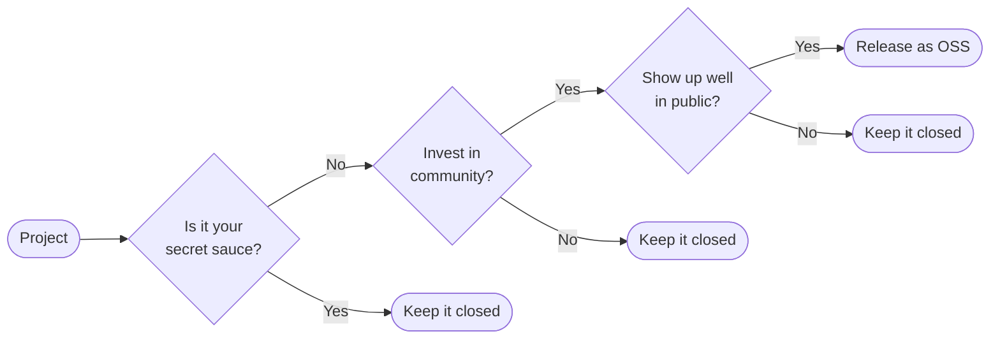

# Risks and Challenges 

Business stakeholders who have heard of open source software but aren't well-educated about what open source is or what it can do for businesses (which is most business stakeholders) tend to **underestimate** the risks from using open source software while **overestimating** the risks from contributing to and/or publishing and maintaining open source projects. When talking with business stakeholders, it's important to be honest about the potential risks from open source software -- both from using OSS anonymously as part of the software stack and from contributing to and creating projects. Business stakeholders aren't stupid; if you don't address these risks head-on you'll lose credibility. It's also important to address the risks open source software can create because you need to find ways to mitigate those risks and protect your organization. For many OSPOs, risk mitigation is a core part of the mission.

It's also important to think critically about risks from your engagement with open source software because there will be times when the risks and downsides outweigh the benefits. In fact, one of the key elements of a mature open source strategy is having a framework for evaluating when it makes sense to use, contribute to and create open source projects, so that risk/benefit calculations aren't based just on gut instinct. 

## Risks and challenges from using open source software

Open source software is everywhere, from programming languages to libraries to end-user applications. Particularly because open source is so critical at the infrastructure layer, it's nearly impossible to find an organization that doesn't have open source software as part of its software stack. From a superficial business perspective, this can seem like a no-brainer -- someone puts code on the internet, you take it and integrate it into your stack. Your engineers are able to work much more effectively, you deliver more features more quickly. Everyone is happy. 

In many organizations, stakeholders outside the engineering organization aren't even aware that open source software is being used at all -- and in some cases, even engineering leadership isn't aware. That's because most engineers will assume that it's ok to use open source components unless they are told otherwise -- it's such an accepted software development practice. They won't necessarily ask for permission to do so, nor will they report on the fact that there are open source components in the stack. To many software engineers, open source components are just the water they swim in; they assume that everyone else assumes they are using them. 

In addition, many software engineers aren’t completely clear on what exactly open source software is, and they certainly aren’t necessarily experts in open source licenses or open source supply chain security.  

There are three main categories of risk that can come from simply using open source. One is security; there can be vulnerabilities or even backdoors in the open source components that render the entire application vulnerable. The second is around legal compliance; just because a project is available on a code collaboration platform like GitHub does not mean the code can be used for absolutely all purposes (first of all, not all software available on code collaboration platforms actually has an open source license, and second of all, some open source licenses do not allow you to use the software to create commercial products). The third category of risk from open source components comes from projects that are no longer maintained, whether it is because the maintainers decide to change the license on all future versions, or because they are no longer willing or able to maintain the project. Like all software, open source projects, whether they are full-fledged end-user applications or niche libraries, require some kind of maintenance. All software can be abandoned, but open source projects can live on GitHub for years without being maintained. It's a myth that all open source projects are maintained by volunteers, but nonetheless many projects are created and maintained by a single person doing the project in their spare time. Therefore, the risk of abandonment is always there, and evaluating project health before using the project is a key way to minimize this risk. When projects are abandoned, among other things they do not get security updates, which can lead to security risks if your team doesn’t manage security updates internally. 

### Security

Whether or not open source software is inherently more secure than closed-source software is debatable. Some people will say that because open source software is visible to all, the transparency means more eyes on the code and a greater likelihood that security vulnerabilities will be uncovered before they go into production. Others argue that closed source software is closed; therefore it's harder for malicious actors to see the code and figure out how to exploit it. Regardless of which camp you're in, it would be naive to think that there are never security issues with open source software, just as there are security issues with closed source software.

There have been a couple of high-profile security vulnerabilities related to open source software in the past several years. The [Log4shell vulnerability](https://www.ncsc.gov.uk/information/log4j-vulnerability-what-everyone-needs-to-know) is one of the more well-known [vulnerabilities in open source software](https://en.wikipedia.org/wiki/Log4Shell), and even though a patch was released there are undoubtedly still many devices that are vulnerable, even years after the vulnerability was disclosed. 

There was also the XZ Utils backdoor [https://en.wikipedia.org/wiki/XZ_Utils_backdoor](https://en.wikipedia.org/wiki/XZ_Utils_backdoor), a backdoor that was injected into a popular Linux library. The backdoor was discovered before the update was put into production widely, but its discovery was largely thanks to chance and a particularly observant software engineer who noticed and investigated strange behavior from the utility in question. Had it gone into production, it would have given complete remote access to millions of machines. In the case of the XZ Utils backdoor, the exploit was a direct result of some of the dynamics that can make open source software vulnerable: A malicious actor spent years gaining the trust of an overwhelmed, unpaid maintainer, who then agreed to give them maintainer write access to the repository. That allowed the malicious actor to accept code that contained the backdoor, almost certainly both the malicious maintainer and the code author were sock puppet accounts. 

There are also security problems in closed-source software, so it’s not like security problems are unique to open source. 

### Legal Compliance

Open source software is not the same as Free Software, there are still restrictions on how the software can be used, especially in the case of software published under copyleft licenses. Open source is not the same as “free software.” Copyleft licenses generally require that modified versions of the software be redistributed under the same license as the original software, which makes using copyleft-licensed projects in commercial software legally risky to impossible. 

Especially in situations where individual contributors aren’t given any guidance about which licenses are or are not allowed, and under which circumstances, there’s a high likelihood that they will use open source projects as if they were completely free of legal restrictions. Most programmers are not particularly knowledgeable about open source licenses, and most assume that open source projects can be used in any circumstance. This can potentially create legal problems for the company in the future. 

### Abandonware / technical debt

Not all open source projects are actively maintained, and an open source project that is actively maintained right now might not continue to be maintained in the future. If you rely on a project that ceases to be maintained for one reason or another, this can create a ripple of problems for your technical team. This is one reason why it’s so important to consider the viability of the open source project and the community health before adopting an open source project (for more on evaluating risk and community health, check out the CHAOSS project’s resources [on risk] (https://www.chaoss.community/practitioner-guide-viability/) and [community health] (https://chaoss.community/)). 

Who owns and maintains the project has a big influence on risk. If it’s a single vendor with a strong contributor license agreement (CLA), they can relatively easily relicense the project. If the project is owned by a direct competitor in your space, that has other risks. In general, open source projects hosted by a foundation are generally the least risky; but the important take-away is to proactively evaluate the risk of abandonment and license changes before becoming dependant on a particular project. 

The good news is that if an open source project is abandoned by the maintainers, you still have the possibility of maintaining it yourself internally. But this creates technical debt, adding to the responsibilities of your engineering team. Just like with legal issues, individual contributors will not necessarily take into consideration the community health of a project before using it unless an OSPO proactively educates them on the importance of community health for the long-term viability of the project. 

## Risks and challenges from contributing to open source software

Of the three ways to be involved with open source software, contributing to other projects is perhaps the least risky. However, there are still challenges that can arise, and there are also perceived risks for business stakeholders. If you’re trying to convince business leaders to allow more open source contributions, it’s important to take their perceived risks seriously.

### The Time Investment

Whether you’re fixing a bug or building a new feature, the initial time investment is going to be bigger if you contribute it back to the community, particularly for the first time contribution; there is a learning curve for contributing to every project. It takes time to understand the contribution process, and it takes time to get a pull request merged. It’s often faster and easier to simply write the fix. 

To be clear: It is faster and easier in the short term if you simply write the fix and don’t contribute upstream. Over the long-term, if you contribute the feature or bug fix to the main project, not only does it benefit the community immediately – others can work on fixing other bugs, for example – but the responsibility for long-term maintenance shifts from your organization to the larger community. 

### You could look bad 

Open source contributions are made by individuals, through individual GitHub accounts. Nonetheless, they are representing your company and your brand. There are two ways this could go wrong. First of all, they could do poor-quality work, which will reflect poorly on your entire engineering organization. Even if the code quality is good but the contributor hasn’t taken the time to review contribution guidelines or to interact with the community at all, it both increases the risk that the pull request will ultimately be rejected while also reflecting poorly on the entire organization. 

Perhaps even worse than poor quality code is poor behavior. Many open source projects suffer from a small percentage of community members who make life difficult for others in the community, who harass others in the community and/or the maintainers. If your team members behave like this in open source communities, people they come into contact with will assume that type of behavior is normal in your organization, and it will actively repel people from working for your company, buying from your company or partnering with your company. 

Open source is about transparency. If you have something to hide, it will come out and ultimately hurt you. 

### Your Competitors Could Benefit

Some business people worry that their competitors could benefit if you contribute a new feature or a bug fix back to an existing project. Technically speaking, this is absolutely true. Your competitors could take your bug fix or feature, use it for themselves and use the time they saved to develop other features that then give them a competitive advantage. 

If there are contributions to a project that you think will give you a competitive advantage in your ecosystem, that is a situation where you shouldn’t contribute back to the open source project. But for software that isn’t a core part of your competitive advantage, you’ll ultimately get more from being active in the community than you’ll lose from giving competitors access to bug fixes and new features that you contribute back to open source projects. 

The truth is, it’s not always easy to make the distinction between these two scenarios. But a good guiding principle is to try to maximize your organization’s benefits, both from the project as a whole as well as from a particular upstream contribution, rather than trying to prevent your competitors from benefiting. 

## Risks and challenges from publishing and maintaining open source software

Publishing your own software projects as open source is generally the toughest sell for business stakeholders, because it feels so much like giving something away for free that you’ve invested resources in creating. The main argument against doing this for business stakeholders is that your competitors will be able to both see what you’re doing and use it themselves. 

### Your Competitors Get Access

If you are developing software internally that gives you a strategic advantage in your ecosystem, you probably don’t want to open source it; and if you do, you want to be very careful about the licensing that you choose. 

However, most companies develop a large number of projects that aren’t directly related to their primary product and that doesn’t provide them a direct competitive advantage. A good example of this is security software. Improving your security posture doesn’t help you sell more widgets, but it can help you avoid a major reputational hit. And you might not want your competitor to have a serious security issue, either: the market’s response might be to lose trust in all of the companies in your market category. So working together on security issues that impact your entire competitive landscape can ultimately benefit everyone, allowing more people to work on innovative features of their own product while also potentially improving the reputation of your market category. 

On the other hand, sometimes you will open source a project and yes, your competitors will get access. They may or may not contribute back to open source, they may just take your project and use it without ever contributing back to it. You have to accept that this might happen, and that the advantages of participating in the open source ecosystem. 

### You’ll Be Responsible for Ongoing Maintenance

This is a very real consideration; when you create an open source project you are making a commitment to maintain the project over the long term. Do projects get abandoned? Yes, you don’t have to maintain the project forever, but the ecosystem will expect that you’re making a commitment to maintain the project over at least a couple years unless you very clearly communicate otherwise. There’s also an expectation that you’ll be responsive if there are security issues. 

This responsibility can be oppressive for hobby projects, and if a project becomes very popular, it can become a burden even for maintainers who maintain the project as part of their employment. It’s also one of the reasons it’s a best practice to take community building seriously: if you proactively take the time to cultivate a community of contributors and build a contributor ladder, you’re less likely to find yourself burdened with maintenance. 

In addition, you should open source projects that are going to continue to be important for your company, and that you would continue to maintain regardless. An “open source first” approach doesn’t mean open sourcing every internal project you create. Open source is an investment over time, and you don’t want to invest that time in a project that you don’t intend to use internally for the long-term.

### The Cyber Resilience Act (CRA) when publishing software

The EU Cyber Resilience Act (CRA) is the first EU-wide legislation to impose cybersecurity requirements across the entire lifecycle of "products with digital elements." It entered into force on 10 December 2024 and will apply in full from 11 December 2027. If your organisation publishes or commercially distributes software in the EU market, the CRA changes what "publishing" means in practice — it is no longer enough to ship code; you need a documented approach to security and vulnerability handling.

This section is awareness-focused. It explains who the CRA affects, what changes when you publish software, and how to prepare. It is not legal advice, and it deliberately does not attempt to be a "how to solve CRA" guide. Deeper technical and compliance resources are signposted at the end of this chapter.

#### Who Is in Scope — and Who Is Not

The CRA takes a deliberately differentiated approach to open source. The regulation only applies to free and open source software that is **made available on the market** in the course of a commercial activity. Software that is published but not monetised by its publisher is generally outside the scope of the manufacturer regime. Contributors who submit code to projects they do not control are also not brought into scope merely by contributing.

Three practical outcomes follow for any given project or release:

- **Manufacturer.** A legal person publishes the software under its name or trademark and places it on the market commercially. The ordinary manufacturer conformity and reporting duties apply.
- **Open-source software steward.** A legal person does not place the software on the market but provides sustained, systematic support for a project intended for commercial activities, and plays a main role in ensuring its viability. A lighter, tailor-made regime applies under Article 24.
- **No CRA duties for that project.** For example, an individual contributor without project control, or a natural person publishing non-monetised software outside commercial activity.

A single organisation can occupy different roles for different editions. A company may be the manufacturer of a paid enterprise edition while acting as the steward of a non-monetised community edition. The licence label alone is not decisive; the Commission's guidance looks at control, commercial activity, and the realities of supply.

#### What Changes for Manufacturers

Where a manufacturer places a product with digital elements on the market — including a commercial open source distribution — the full manufacturer obligations apply. This includes conformity with the essential cybersecurity requirements in Annex I, technical documentation, vulnerability handling, and reporting.

A critical point for business leaders: **a manufacturer cannot transfer its CRA obligations to an open source project by supporting it financially or otherwise**. When a manufacturer integrates open source components into its product, it remains responsible for the compliance of the product as a whole, including exercising due diligence on those components. Poorly maintained open source dependencies do not excuse the manufacturer from its own due diligence requirements.

This is a supply-chain governance issue, not merely a legal one. Engineering and procurement teams need a shared view of which components are critical, how they are maintained, and what happens if an upstream project changes direction.

#### What Changes for Open Source Stewards

Article 24 introduces a light-touch regime for stewards. The core obligations are threefold:

1. **A documented cybersecurity policy.** The steward must put in place and document, in a verifiable manner, a policy to foster secure development and effective vulnerability handling by the project's developers.
2. **Cooperation with market surveillance authorities.** Stewards must cooperate with authorities responsible for enforcing the CRA.
3. **Reporting.** Stewards must report actively exploited vulnerabilities and severe incidents that have an impact on the security of products with digital elements.

The cybersecurity policy requirement applies to the project's own development practices, not to how downstream integrators use the code. Stewards are also explicitly exempt from administrative fines under Article 64(10), which reinforces the proportionate, enabling intent of the regime.

The steward category matters for businesses because it creates a recognised, stable legal identity for the organisations that keep critical open source projects viable. If you publish open source and want others to depend on it, understanding whether you are a manufacturer, a steward, or neither is part of publishing responsibly.

#### The Timeline: What Happens When

The CRA does not arrive all at once. Key dates are:

| Date | What applies |
|---|---|
| **10 December 2024** | CRA enters into force |
| **11 June 2026** | Articles 35–51 apply; Member States must designate notifying authorities |
| **11 September 2026** | Article 14 reporting obligations apply; manufacturers must notify actively exploited vulnerabilities and severe incidents via the single reporting platform |
| **11 December 2027** | Full application: essential requirements, market surveillance, and all remaining provisions |

For publishers, **September 2026** is the first operationally significant deadline for incident reporting. The full conformity regime follows in December 2027. Planning should not wait for the final deadline.

#### Practical Readiness Checklist for Publishers

This checklist is deliberately high-level. It is intended to help business and engineering stakeholders ask the right questions, not to serve as a compliance certification.

- **Map your exposure.** Identify which products, editions, and commercial offerings fall within scope, and whether your organisation acts as manufacturer, steward, or both for each.
- **Clarify the commercial-activity boundary.** For each project you publish, document whether it is monetised, how, and by whom. Treat community and paid editions separately.
- **Assess upstream dependency health.** For critical components, evaluate maintenance activity, vulnerability history, release cadence, and governance. The CRA makes due diligence on open source components a publisher responsibility, so this is no longer optional good practice.
- **Prepare for vulnerability reporting.** Establish internal processes to identify, assess, and report actively exploited vulnerabilities and severe incidents in line with the Article 14 timeline.
- **Document your cybersecurity policy.** If you are a steward, ensure the project has a documented, verifiable policy covering secure development and vulnerability handling. If you rely on a steward, ask to see it.
- **Record your decisions.** The CRA rewards verifiable, documented processes. Record how you assessed scope, roles, and due diligence. This evidence will matter in market surveillance and in internal governance.

## Legislative risks related to open source software

The CRA is not an isolated regulation. It sits within a broader trend of EU legislation that is reshaping expectations for software supply chains, transparency, and security. For business leaders, the question is not whether to engage with this trend, but how to do so proportionately and early enough to avoid reactive, costly compliance.

### The Risk of Doing Nothing

The most visible risk is non-compliance: products that do not meet the essential requirements cannot be placed on the EU market once the full regime applies in December 2027. But the less visible risks are often more expensive.

- **Supply-chain fragility.** The CRA makes publishers responsible for the compliance of their products as a whole, including open source components. If a critical dependency is unmaintained or its stewardship is unclear, that becomes a publisher risk. Teams that have not mapped this exposure will discover it under pressure.
- **Contractual and procurement friction.** As CRA expectations diffuse through the market, buyers will increasingly ask suppliers about their compliance posture. Suppliers who cannot answer clearly will face longer sales cycles, additional contractual conditions, or exclusion from procurements.
- **Reputational and regulatory attention.** The reporting obligations that begin in September 2026 create a visible trail of incident handling. Organisations that are seen to handle vulnerabilities poorly, or that cannot demonstrate a documented approach, invite scrutiny.
- **Late, expensive remediation.** Waiting until 2027 compresses remediation into a short window. The organisations that start now can spread the work across normal engineering and procurement cycles.

### The Business Case for Early Engagement

Engaging with the CRA early is not only defensive. It creates genuine business advantages.

**It strengthens procurement decisions.** The CRA gives procurement teams a structured vocabulary for evaluating open source risk: manufacturer vs. steward, commercial activity vs. non-monetised publication, documented cybersecurity policy, vulnerability handling. Embedding these questions into supplier evaluation improves the quality of procurement decisions beyond CRA compliance alone.

**It clarifies the value of commercial open source support.** Purchasing support, maintenance, or managed services from a provider that has clarity on its CRA role is a way to transfer operational responsibility and reduce uncertainty. The CRA makes the distinction between "free code" and "supported product" more legible, which is useful for budget owners.

**It aligns with existing open source governance.** Organisations that already run an OSPO, maintain an SBOM programme, or participate in OpenChain or OpenSSF activities are closer to CRA readiness than they may realise. SPDX, OpenSSF Scorecard, and OpenChain frameworks are directly relevant to the due diligence and documentation the CRA expects. The CRA is a reason to consolidate and formalise practices that many mature organisations already have.

**It supports long-term sustainability.** The steward category recognises the organisations that keep critical projects viable. Businesses that understand this landscape can make more intentional decisions about which projects and providers to support, and how, so that the open source they depend on remains healthy.

### How to Engage Proportionately

The CRA does not require every organisation to become a compliance specialist. A proportionate approach looks like this:

1. **Assign ownership.** Someone in the organisation — often in OSPO, procurement, legal, or product security — should own the CRA question and maintain a view of scope and roles.
2. **Use existing frameworks.** Lean on OpenChain, OpenSSF, SPDX, and the ORC Working Group's resources rather than building a bespoke compliance programme from scratch.
3. **Start with the highest-risk products and dependencies.** Not everything needs to be addressed at once. Prioritise commercial offerings and critical upstream components.
4. **Engage upstream.** If you depend on a project, participate in its security and governance discussions. If you are a steward, document your policy. If you are a manufacturer, exercise due diligence visibly.
5. **Revisit as the timeline advances.** The September 2026 reporting milestone is the first operational test. Use it to validate processes before the full regime applies in December 2027.

### Further Reading

This chapter is an awareness-level introduction. The following resources provide deeper guidance. They are maintained by the open source community and by public authorities; they are listed for information and do not constitute legal advice.

- **European Commission — Cyber Resilience Act and Open Source**: The official EU page explaining how the CRA treats free and open source software, including the steward category and the main obligations. [https://digital-strategy.ec.europa.eu/en/policies/cra-open-source](https://digital-strategy.ec.europa.eu/en/policies/cra-open-source)
- **Open Regulatory Compliance (ORC) Working Group**: A community of manufacturers, foundations, and maintainers producing free, actionable CRA resources, including FAQs and compliance guidance. [https://orcwg.org/](https://orcwg.org/)
- **ORC CRA FAQ**: Practical answers on timelines, steward obligations, manufacturer due diligence, and scope questions. [https://cra.orcwg.org/faq/](https://cra.orcwg.org/faq/)
- **OpenSSF — CRA resources**: Guidance and tooling from the Open Source Security Foundation, including how SPDX 3.0, OpenSSF Scorecard, and OpenChain support CRA readiness. [https://openssf.org/](https://openssf.org/)
- **OpenChain**: ISO/IEC 18974-aligned open source compliance and security frameworks relevant to CRA due diligence and SBOM practices. [https://www.openchainproject.org/](https://www.openchainproject.org/)
- **SPDX**: The ISO/IEC 5962 standard for software bill of materials, widely used for CRA-recognised SBOM formats. [https://spdx.dev/](https://spdx.dev/)

## How to properly budget or allocate resources for OSPOs?

## Strategies for minimizing the risks and downsides from open source

When it comes to minimizing the risks from open source, it's important to take into consideration that the risks are different for each type of involvement with open source (user, contributor, maintainer). It's also important to consider that if you're a maintainer of an open source project, you're likely also a contributor and user of open source software. So you'll have to consider risk mitigation strategies for all the ways that you interact with open source software. 

### Mitigating risk from using open source software

The primary risks from using open source software are related to security, legal compliance and potential abandonment of the project. For all three types of risks, the most important first step is to create a register of all the open source projects used in your organization, which includes a complete Software Bill of Materials (SBOM) for your software. Because using open source projects is so second-nature for most software engineers, they'll often just download and use an open source component without recording it anywhere. 

There are many tools that exist to scan for open source projects and check the security and license compliance for those projects, and the same for legal compliance. The sheer number of open source projects in most organizations means that it is impossible to maintain security and compliance without tooling. 

In terms of mitigating the risk from unmaintained projects, it's important to understand which projects are under-resourced and at risk of being abandoned as well as which projects are particularly essential for your organization. 

### Mitigating risk from contributing to and publishing open source software 

The main risks from contributing to and publishing open source comes from a potential for wasted time and intellectual property that is made accessible for others to use. 

Avoid wasting your team’s time by ensuring they read contribution guidelines, building relationships in communities and understanding what kinds of contributions are and are not accepted before spending time working on a pull request. 
Avoid risks from losing control of your intellectual property by reviewing both contributions to other projects and projects you publish for strategic significance, before the process of preparing for an open source release begins. 
Avoid reputational risks from doing open source poorly by following the spirit of open source, not just the legal definition. 

The best way to do all three of those is with a written open source policy that is proactively disseminated throughout the organization. It is not a technology problem, it is an internal communication problem. 

## When not to open source your software 
Inevitably, there are times when open source is not appropriate. Just as you shouldn’t avoid open source categorically, you shouldn’t assume that open source is always the right answer, either for using or contributing. 

When it comes to using open source software, many organizations have a ‘default to open’ policy, in which they will always use open source unless there is a compelling reason not to. However, crucially they also take the time to put in place frameworks to help decide whether or not there is a compelling reason – and they evaluate projects case by case. 

When it comes to publishing your own internal software projects as open source projects, here are a couple situations when internal projects should remain internal projects.

### It is your secret sauce

The most obvious situation is when the software in question is how you build a competitive advantage. If your crucial IP is in the software, you might want to keep it closed source. 

There is an exception to this rule, however. If you have decided to build what is often called an open source company, in which a large percentage of your IP is open source, there can be strategic advantages to doing so, but you need to make a conscious, well-thought-out  decision to follow this path. You’ll want to consider both what license to choose as well as how you expect the open source project to contribute to your business goals. 

### You’re not committed to the ‘spirit’ open source

In most cases, merely having your code publicly available isn’t going to provide business benefits (the exception is if transparency is important; still, this can be achieved with relatively restrictive licenses). The value of open source comes primarily from building a community, from getting feedback from users, and from building relationships with others who are tackling similar problems. On the other hand, it takes investment for those things to happen. If you’re not interested in community building or collaboration, you won’t get the full benefits from engaging with open source software while still exposing your organizations to the same risks. 

### Your code is sloppy and/or you’re not likely to be able to show up in the community in a positive way

The last reason to avoid open source is because, quite frankly, you have something to hide. Before laughing at this idea, consider that in fact it’s a very common reason that companies give for not wanting their source code in the open: they don’t think the code quality is good enough. This goes for contributing to open source as well: If your code contributions are not high-quality, you will actively hurt your reputation. 

But poor code quality is not the only way to ruin your reputation in open source. Perhaps the worst way to ruin a reputation in the open source community is poor people skills. Even if it’s just asking questions in a Discord, if you aren’t reasonably respectful you can hurt your individual and your company reputation. But this goes for plenty of situations in an open source community. It’s important to read contribution guidelines, to make sure you are following AI use guidelines, and in general to show up in a way that is helpful and respectful of others. If you are building your own community, obviously you want it to be the kind of place that others want to be part of; if you can’t do that, it’s best not to try. 

It is better to not do something than to do it poorly, and being involved in open source is no exception. If your code quality is not good, don’t open source it. If you can’t be a respectful member of a community, don’t join the community. 

At an organizational level, it’s important to remember that the actions of individual employees reflect on the entire organization. It’s why governance is so important; you need employees to understand when and when not to get involved in open source, and you need a way to educate them about acceptable ways to show up in those communities, so that at the very least they do not harm your organization’s reputation. 

### In summary

It would be a mistake to always open source your code, and it would be a mistake even to say that you should always, under every circumstance, use open source projects instead of closed-source products. Some organizations have a ‘default to open source’ policy, which is that unless there is a compelling reason otherwise, they will use open source, contribute their fixes and features they develop for internal projects back to the upstream project, and release internal software projects as open source projects. However, there is still a review process in place to ensure that there aren’t compelling reasons to avoid open source. Creating a governance framework so that anyone in the organization can evaluate whether or not an open source approach is appropriate to a specific situation is one of the roles of an Open Source Program Office (OSPO), and it is essential for organizations who have a mature approach to open source. 
